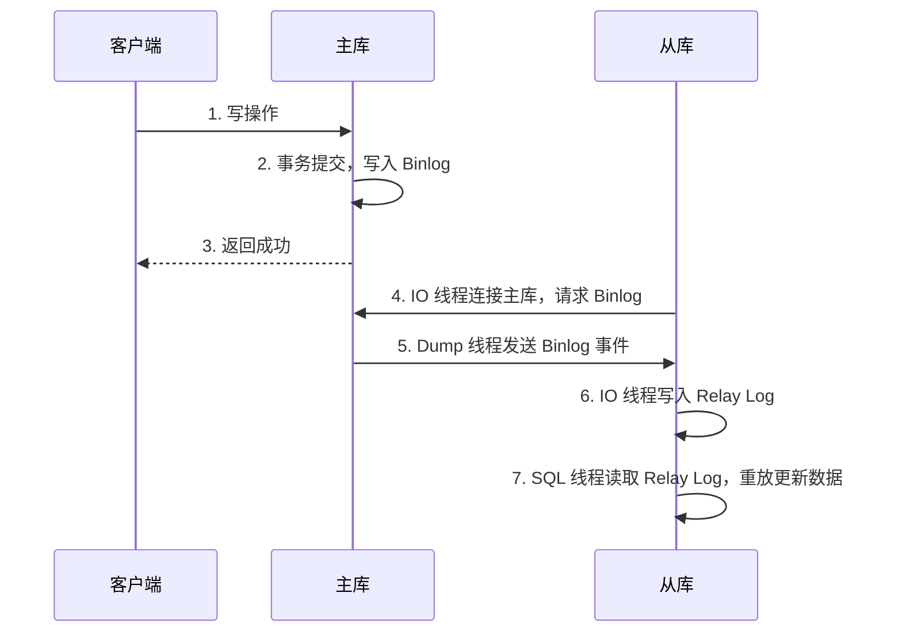

# MySQL 主从同步原理与实现

## 目录

1. [核心作用](#核心作用)
2. [核心原理：基于 Binlog 的日志复制](#核心原理基于-binlog-的日志复制)
3. [读写分离为什么有效](#读写分离为什么有效)
4. [Binlog 的三种记录格式](#binlog-的三种记录格式)
5. [主从同步的三种模式](#主从同步的三种模式)
6. [基于 VIP + Keepalived 的高可用切换方案](#基于-vip--keepalived-的高可用切换方案)
7. [GTID 复制机制](#gtid-复制机制)
8. [主从延迟原因与解决方案](#主从延迟原因与解决方案)
9. [常用配置参数](#常用配置参数)

---

## 核心作用

主从同步（Replication）是 MySQL 实现**数据冗余、读写分离、高可用、故障恢复**的核心机制。

| 作用 | 说明 |
|------|------|
| **数据备份** | 从库实时备份主库数据 |
| **读写分离** | 主库写，从库读，分担压力 |
| **高可用** | 主库故障时，从库可切换为主库 |
| **容灾恢复** | 跨机房/跨地域部署从库 |

---

## 核心原理：基于 Binlog 的日志复制

MySQL 主从同步的本质是：**主库记录变更日志（Binlog），从库重放日志，使数据保持一致**。

### 三个核心日志文件

| 日志 | 位置 | 作用 |
|------|------|------|
| **Binlog** | 主库 | 记录主库所有数据变更（DDL、DML） |
| **Relay Log** | 从库 | 从库保存从主库拉取的 Binlog 事件 |
| **Master Info / Relay Log Info** | 从库 | 记录从库读取到主库 Binlog 的位置（file + position） |

### 核心流程图



### 详细步骤

1. **主库写 Binlog**
   - 客户端在主库执行写操作
   - 事务提交时，主库将变更写入 **Binlog**
   - `sync_binlog` 参数控制 Binlog 刷盘策略

2. **从库 IO 线程连接主库**
   - 从库启动 `IO_thread`，与主库建立连接
   - 向主库请求从某个位置（`file + position`）开始的 Binlog

3. **主库 Dump 线程发送 Binlog**
   - 主库为每个从库连接创建一个 `Binlog Dump` 线程
   - Dump 线程读取 Binlog 并发送给从库

4. **从库写入 Relay Log**
   - 从库 IO 线程接收 Binlog 事件
   - 写入从库的 **Relay Log**（中继日志）

5. **从库 SQL 线程重放**
   - `SQL_thread` 读取 Relay Log
   - 按顺序解析并执行其中的 SQL 事件
   - 应用到从库的数据库中

---

## 读写分离为什么有效

读写分离的核心价值：**将读查询从主库分流到从库，让主库专注处理写操作，整体提升系统吞吐量。**

### 疑问：从库也有写操作（复制回放），读写分离还有意义吗？

**有，因为从库的写和主库的写完全不同。**

### 主库 vs 从库的写操作对比

| 维度 | 主库（应用写入） | 从库（复制回放） |
|------|------------------|------------------|
| **写入模式** | 随机写（更新不同行、不同索引） | 顺序写（按 binlog 顺序回放） |
| **锁竞争** | 严重（多事务并发，行锁/表锁阻塞读） | 几乎无（SQL 线程单线程回放，MVCC 快照读不冲突） |
| **伴随操作** | undo log + redo log + binlog + 锁管理 + 事务管理 | 仅重放已计算好的操作 |
| **CPU 消耗** | 高（锁管理、索引维护、事务协调） | 低（简单重放） |
| **I/O 模式** | 复杂（随机读写混合） | 简单（顺序写 + 随机读） |

### 顺序写为什么 I/O 友好？

- **顺序写**：数据连续追加到文件末尾，磁盘不需要寻道
- **随机写**：数据分散写到不同位置，磁盘需要频繁寻道（HDD 差距 100 倍以上）
- 从库复制是 **追加写入 relay log + 顺序回放**，I/O 效率极高

### 性能对比

假设主库原本处理：1000 写 + 10000 读 = 11000 次操作，读写互相干扰

读写分离后：
- **主库**：只处理 1000 写，无读查询干扰
- **从库**：处理 10000 读 + 1000 复制回放（顺序写开销可忽略）
- **整体**：主库写性能提升 + 从库读能力水平扩展（可加多个从库）

### 适用场景

读写分离适合**读多写少**的场景（读写比 10:1 以上效果明显）：

| 场景 | 读写比 | 是否适合 |
|------|--------|----------|
| 电商商品详情页 | 100:1 | ✅ 非常适合 |
| 社交媒体信息流 | 50:1 | ✅ 适合 |
| 订单系统 | 10:1 | ✅ 可以 |
| 金融转账系统 | 1:1 | ❌ 不适合（延迟不可接受） |

> **注意**：如果写操作很多，从库复制会延迟严重，读到的数据太旧，此时读写分离效果有限。

---

## Binlog 的三种记录格式

Binlog 是主从同步的基础，有三种格式：

| 格式 | 英文 | 特点 | 优缺点 |
|------|------|------|--------|
| **Statement** | 基于语句 | 记录原始 SQL 语句 | 体积小，但某些函数（如 UUID、NOW()）可能导致主从不一致 |
| **Row** | 基于行 | 记录每行数据变更前后的值 | 数据一致性高，但日志体积大 |
| **Mixed** | 混合模式 | 默认用 Statement，部分场景自动切换为 Row | 折中方案 |

> **MySQL 5.7+ 默认推荐 `ROW` 格式**，因为它能保证主从数据强一致。

---

### 三种模式对比

| 模式 | 流程 | 优点 | 缺点 |
|------|------|------|------|
| **异步复制** | 主库写 Binlog 后立即返回，后台异步同步 | 性能最好 | 主库宕机可能丢数据 |
| **半同步复制** | 主库等待至少一个从库确认后才返回 | 降低数据丢失风险 | 增加主库响应延迟 |
| **组复制** | 基于 Paxos 协议，事务提交需组内大多数节点确认 | 强一致性、自动故障切换 | 配置复杂、性能开销大 |

---

## 基于 VIP + Keepalived 的高可用切换方案

读写分离架构中，**主库是唯一的写入口**。使用 **VIP（虚拟 IP）+ Keepalived** 实现主库故障时的快速切换。

### 核心思路

- 业务连接 VIP（虚拟 IP），VIP 绑定在当前主库上
- 主库宕机后，Keepalived 将 VIP 漂移到从库，并将从库提升为新主库
- 应用层无需修改连接地址

### 架构图

```
                 ┌─────────────────┐
                 │   业务应用       │
                 │  连接 VIP:3306  │
                 └────────┬────────┘
                          │
                  ┌───────┴───────┐
                  │  VIP 浮动地址  │
                  └───────┬───────┘
                          │
              ┌─────────────┼─────────────┐
         ┌────┴────┐   ┌────┴────┐   ┌────┴────┐
         │  Master │   │  Slave1 │   │  Slave2 │
         │ priority=100  │   │ priority=90  │   │ priority=80  │
         └─────────┘   └─────────┘   └─────────┘
```

### 工作流程

1. **正常状态**：VIP 绑定在 Master，应用通过 VIP 写入
2. **Master 宕机**：Keepalived 检测故障，VIP 漂移到优先级最高的 Slave，触发提升脚本
3. **应用恢复**：应用 reconnect 到 VIP，写流量进入新主库

### 关键配置

**Keepalived 主库配置**（从库类似，state 改为 BACKUP，priority 降低）：

```bash
vrrp_instance VI_1 {
    state MASTER              # 从库改为 BACKUP
    priority 100              # 从库改为 90/80
    virtual_router_id 51      # 所有节点必须相同
    virtual_ipaddress {
        192.168.1.100/24
    }
    track_script {
        check_mysql           # MySQL 健康检查脚本
    }
}
```

**从库提升脚本**（VIP 漂移后触发）：

```bash
#!/bin/bash
mysql -uroot -p密码 -e "STOP SLAVE;"
mysql -uroot -p密码 -e "RESET SLAVE ALL;"
mysql -uroot -p密码 -e "SET GLOBAL read_only=0;"
```

### 优点与风险

| 优点 | 风险 |
|------|------|
| 配置简单，部署成本低 | 异步复制下可能丢数据 |
| 对应用透明（连接 VIP） | 网络抖动可能导致脑裂 |
| 秒级完成 VIP 漂移 | 提升脚本必须可靠 |

---

## GTID 复制机制

GTID（Global Transaction Identifier）是 MySQL 5.6+ 的全局事务标识，用于替代传统的 `file + position` 定位。

```
GTID = server_uuid:transaction_id
```

| 对比项 | 传统复制 | GTID 复制 |
|--------|----------|-----------|
| 定位方式 | Binlog file + position | GTID 集合 |
| 主从切换 | 需要手动找位置 | 自动定位，避免跳号 |
| 事务追踪 | 不便追踪 | 每个事务有唯一 ID |

> **生产建议**：新部署的 MySQL 集群直接使用 GTID 模式，主从切换更方便。

---

## 主从延迟原因与解决方案

### 延迟原因

| 原因 | 说明 |
|------|------|
| **单线程复制** | MySQL 5.5 及以前 SQL 线程单线程，重放慢 |
| **大事务** | 主库一个事务修改大量数据，从库重放耗时长 |
| **从库性能差** | 硬件配置低，I/O 或 CPU 瓶颈 |
| **网络延迟** | 主从跨机房部署 |

### 解决方案

1. **并行复制**：开启 MTS（Multi-Threaded Slave），MySQL 5.7+ 支持
2. **硬件升级**：从库使用 SSD，提升 I/O 性能
3. **避免大事务**：业务层拆分
4. **延迟监控**：读请求路由到延迟小的从库
5. **半同步复制**：降低数据丢失风险（但会增加主库延迟）

---

## 常用配置参数

| 参数 | 说明 |
|------|------|
| `server-id` | 主从节点唯一标识，必须不同 |
| `log-bin` | 开启 Binlog |
| `binlog_format` | Binlog 格式（推荐 ROW） |
| `sync_binlog` | Binlog 刷盘策略（1=每次刷盘） |
| `innodb_flush_log_at_trx_commit` | redo log 刷盘策略（1=每次刷盘） |
| `read_only` | 从库设置只读 |
| `gtid_mode` | 开启 GTID 复制 |
| `slave_parallel_workers` | 并行复制线程数 |

---

## 总结

> **MySQL 主从同步是基于 Binlog 的日志复制机制，通过 IO 线程拉取、SQL 线程重放实现数据一致性。读写分离之所以有效，是因为从库的复制回放是顺序写、无锁竞争，开销远小于主库的随机写。根据同步方式可分为异步、半同步和组复制，生产环境常结合 GTID、并行复制和 VIP 高可用方案构建读写分离架构。**
