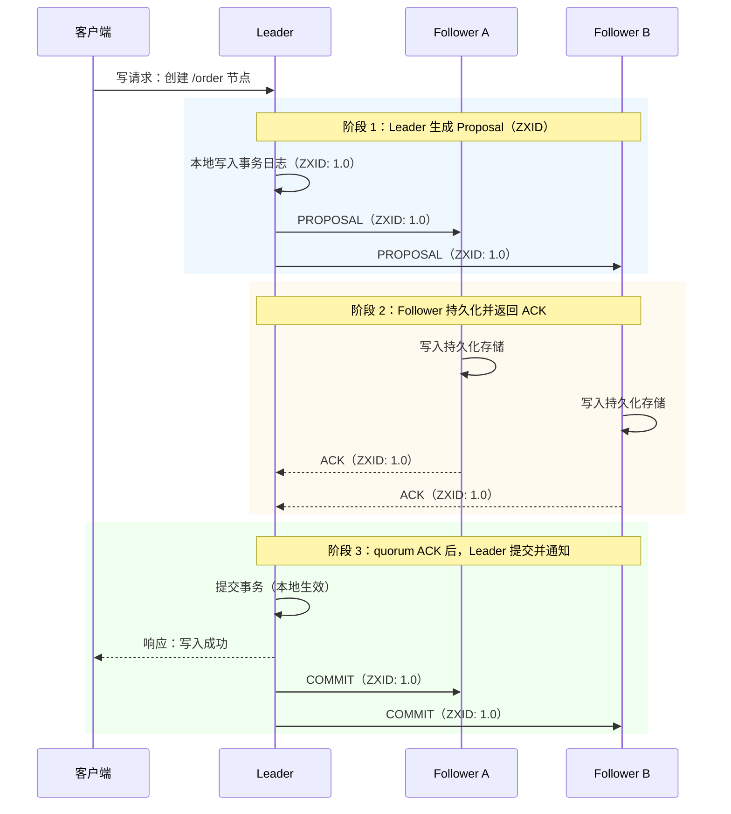
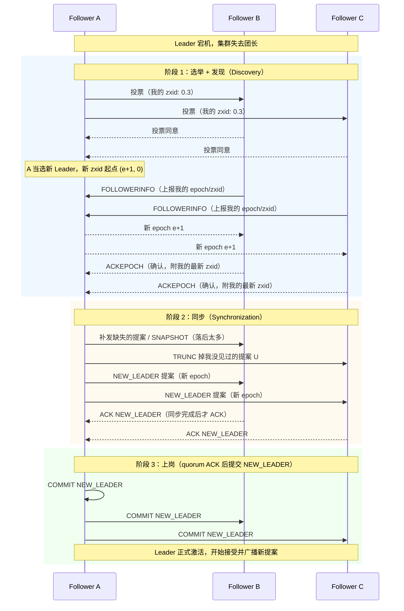

# Zab 一致性协议笔记（ZooKeeper 原子广播协议）

## 一、Zab 是什么

Zab（ZooKeeper Atomic Broadcast，**ZooKeeper 原子广播协议**）是 ZooKeeper 底层使用的**崩溃恢复型原子广播协议**，由 Yahoo 研究团队设计，随 ZooKeeper 一起于 2010 年开源（论文：*Zab: High-performance broadcast for primary-backup systems*，Junqueira 等，2011）。

Zab 在目标上与 Raft / Multi-Paxos 一致——**让多台机器对同一条日志序列达成一致**，但它解决的问题视角略有不同：

- **共识算法（Raft/Paxos）**：强调「从多个提案中选出一个值」
- **原子广播（Zab）**：强调「把 Leader 产生的消息序列，按相同顺序可靠地投递给所有副本」

> 一句话：**Zab = 消息原子广播（Active Messaging）+ Leader 激活/崩溃恢复（Leader Activation）**，两者配合保证「要么所有副本都收到某条消息，要么都没收到」，且顺序一致。

### 核心保证（官网原文三条）

| 保证 | 英文 | 含义 |
|------|------|------|
| **可靠投递** | Reliable delivery | 如果某台服务器投递了消息 m，则**所有**服务器最终都会投递 m |
| **全局有序** | Total order | 如果消息 a 在消息 b 之前被某台服务器投递，则 a 在所有服务器上都先于 b |
| **因果有序** | Causal order | 如果发送方在投递 a 之后发出 b，则 b 必须排在 a 之后；同一发送方依次发出的消息保持原有顺序 |

### 设计约束

- **FIFO 通道假设**：Zab 假设服务器之间是点对点 FIFO 通道（基于 TCP 实现），保证消息按发送顺序到达、通道关闭后不再收到消息
- **FLP 与超时**：FLP 定理证明异步系统中存在故障时不可能保证共识一定达成，因此 Zab 用**超时**保证活性（liveness）；但**正确性（correctness）不依赖时间**——超时被破坏（如时钟偏移）时系统只会挂起，不会违反上述保证
- **高效易实现**：ZooKeeper 每秒要处理数千请求，协议必须高效、可靠、对工程师友好——这是 Zab 不直接套用 Paxos 的重要原因

---

## 二、角色与术语

### 角色定义

| Zab 角色 | 旅游场景角色 | 职责 |
|----------|------------|------|
| **Leader** | 团长 | 唯一的写请求处理者，将写操作转为 Proposal 并广播给 Follower |
| **Follower** | 普通团员 | 接收并持久化 Leader 的 Proposal，返回 ACK，接收 Leader 的 COMMIT 指令 |
| **Observer** | 旁观记录员 | 同步 Leader 的数据但不参与投票（ACK 不算数），用于扩展读性能 |

**一句话**：正常运行时只有一个 Leader 负责写；Follower 参与过半数确认；Observer 只旁观不投票，纯粹分摊读流量。

### 术语对照（官网定义）

| 术语 | 英文含义 | 中文对照 | 说明 |
|------|---------|---------|------|
| **Packet** | 通过 FIFO 通道发送的字节序列 | 数据包 | 通信的最小单位 |
| **Proposal** | A unit of agreement | 提案 | 达成一致的基本单位，通过与 quorum 交换 packet 来达成共识；**多数 Proposal 包含 Message，但 NEW_LEADER 提案不包含** |
| **Message** | 待原子广播的字节序列 | 消息 | 被放入 Proposal 中、达成一致后才被投递 |

---

## 三、核心数据结构：ZXID

Zab 用 **ZXID**（ZooKeeper Transaction ID）标识每一条提案，精确反映提案的全局顺序。

ZXID 是一个 **64 位整数**，分两部分：

```
高 32 位          低 32 位
┌────────────┬─────────────────┐
│   epoch    │     counter     │
│ （Leader 届次）│ （本届内提案序号） │
└────────────┴─────────────────┘
```

| 组成 | 含义 | 类比 |
|------|------|------|
| **epoch**（高 32 位） | 代表**领导权的变更**，每次新 Leader 上任都有自己的 epoch 编号 | Raft 的 Term（任期） |
| **counter**（低 32 位） | 本届 Leader 内提案的递增序号，从 0 开始 | 本届内的「第几号决议」 |

**ZXID 的分配规则**（官网原文）：

- Leader 只需**递增 zxid** 即可为每个提案生成唯一编号
- **领导权激活（Leader Activation）保证同一 epoch 只有一个 Leader 使用**，因此简单的递增算法即可保证全局唯一
- **新 Leader 确立新 zxid 的方式**：取自己见过的最高 epoch `e`，将下一个可用 zxid 设为 **`(e+1, 0)`**

**一句话**：ZXID 大就是新。比较两个 ZXID 先比 epoch，epoch 相同再比 counter，与 Raft「先比 Term，再比日志索引」的思想完全一致。

---

## 四、核心机制

### 1. 消息广播（Active Messaging，正常运行时）

Zab 的消息广播是**无需处理 abort 的经典两阶段提交**（官网原话：*looks just like 2 phase commit without the need to handle aborts*）：只有「提案 + 确认 + 提交」。



**关键点**：

- **ACK 的含义是「已写入持久化存储」**（recorded to persistent storage），不只是收到消息
- Leader 收到 **quorum（过半数，含 Leader 自己）** 的 ACK 后即可提交并广播 COMMIT
- **Quorum 定义**：任意两个 quorum 至少有一台服务器交集；ZooKeeper 默认采用多数派（n/2+1），也支持权重/分组等可配置的 quorum 构造方式
- 与 2PC 的本质区别：**没有 abort 路径**。失败只发生在 Leader 崩溃时，统一交给崩溃恢复处理
- **全局有序的实现依赖四条严格顺序约束**（官网原文）：
  1. Leader 以**接收请求的顺序**向所有 Follower 发送提案（FIFO 通道保证 Follower 也按序收到）
  2. Follower 按接收顺序处理并 **ACK**（若 m 已写入持久化存储，则 m 之前的所有提案都已写入）
  3. Leader 在 quorum ACK 后立即按序发出 **COMMIT**
  4. Follower 按序处理 COMMIT，提案被提交时才投递其中的消息

> 注意：如果违反上述任何一条 FIFO 顺序约束，协议就会失效（官网原话：*If we do not maintain strict FIFO ordering of all packets, it all falls apart*）。这是 Zab 与 2PC 的本质差异之一——**Zab 有跨提案的顺序要求**。

### 2. 崩溃恢复（Leader Activation，Leader 挂了怎么办）

Leader 宕机或失去 quorum 的连接时，集群进入**领导权激活**阶段。官网要求选举结果满足两条：

1. **新 Leader 必须见过所有 Follower 中最高的 zxid**（正确性依赖这一条）
2. **quorum 的服务器已承诺跟随该 Leader**（只需大概率成立，因为后续还会复检；若激活中失去 quorum，则放弃激活、重新选举）

激活过程分发现、同步、上岗三步：



**同步阶段必须解决的两个问题**：

| 问题 | 场景 | Zab 的处理 |
|------|------|-----------|
| **已提交的事务不能丢** | Leader 收到 quorum ACK 并 COMMIT 后宕机，部分 Follower 还没收到 COMMIT | 新 Leader 拥有所有已提交提案（选举保证），把这些提案重新补发 COMMIT |
| **未提交的事务要丢弃** | Leader 只复制到少数 Follower 就宕机，这些提案从未 COMMIT | 新 Leader 会要求持有这些提案的 Follower **TRUNC（截断）**丢弃。官网证明：Follower 带着 Leader 没见过的提案 U 到来时，U 的 zxid 必然更高，而选举该 Leader 的 quorum 没见过 U，说明 U 从未被提交，可以安全丢弃 |

**Leader 上岗的五条基本规则**（官网原文）：

1. Follower 与 Leader 完成同步后，才会 ACK NEW_LEADER 提案
2. 一个 Follower 对同一 zxid 的 NEW_LEADER 提案**只会 ACK 一个 Leader**（防止旧 Leader 冒充）
3. 新 Leader 在 **quorum 的 Follower ACK 后**才 COMMIT NEW_LEADER 提案
4. NEW_LEADER 被 COMMIT 时，Follower 会提交从 Leader 处收到的所有状态
5. **NEW_LEADER 被 COMMIT 之前，新 Leader 不接受任何新提案**

> 注意：NEW_LEADER 提案是「不含消息」的提案，它是新 Leader 正式上岗的宣告。如果选举出错（比如分裂出两个 Leader），NEW_LEADER 无法获得 quorum ACK 而被提交，超时后所有节点会回到选举状态——这是 Zab 对错误选举的兜底。

### 3. 新节点加入与历史数据同步

新 Follower 加入集群或长期落后的 Follower 恢复时，Leader 不会从头逐条重放所有提案，而是：

1. 缺失不多的：补发缺失的提案（DIFF，按 zxid 顺序）
2. 落后太多的：发送**全量快照（SNAPSHOT）**快速对齐
3. 如果 Follower 上有 Leader 没见过的未提交提案：执行 **TRUNC** 截断丢弃

---

## 五、Zab 与 Raft 的对比

| 对比项 | Zab | Raft |
|--------|-----|------|
| **所属组件** | ZooKeeper | Etcd、Consul、TiKV 等 |
| **协议定位** | 崩溃恢复型原子广播 | 分布式共识算法 |
| **任期标识** | epoch（ZXID 高 32 位） | Term |
| **日志序号** | counter（ZXID 低 32 位），epoch+counter 合一 | （Term, 索引）二元组 |
| **角色** | Leader / Follower / Observer | Leader / Follower / Candidate |
| **新 Leader 要求** | 必须见过所有 Follower 中最高的 zxid | 日志至少和投票者一样新 |
| **新 Leader 上岗** | 需提交 NEW_LEADER 提案（quorum ACK 后才激活） | 选举成功即可开始日志复制 |
| **广播形态** | 类 2PC（PROPOSAL + ACK + COMMIT，无 abort） | 单阶段 AppendEntries（复制+心跳二合一） |
| **顺序性基础** | 严格依赖 TCP FIFO 通道的四条顺序约束 | Leader Append-Only + 日志匹配（Log Matching） |
| **崩溃恢复** | 领导权激活（发现 + 同步 + NEW_LEADER 提交），含 TRUNC/SNAPSHOT | 选举 + AppendEntries 一致性检查自动修复 |

**一句话关系**：Zab 和 Raft 是同一思想（强 Leader + quorum + 任期递增）的两个工程化身，差异主要在术语和恢复流程的组织方式上；**Zab 多出 Observer 角色和显式的 NEW_LEADER 激活仪式，恢复流程拆分为发现与同步两个阶段**。

---

## 六、常见误区澄清

| 误区 | 正确理解 |
|------|---------|
| 「Zab 就是 2PC」 | 官网说 active messaging *looks just like 2 phase commit without the need to handle aborts*——**形态像**（提案 + 确认 + 提交），但没有协调者否决/回滚路径，且有**跨提案的严格 FIFO 顺序要求**，这是 2PC 没有的 |
| 「Zab 就是 Multi-Paxos / Paxos 的变种」 | 官网明确回答 *No*：Multi-Paxos 依赖「只有一个协调者」的外部保证，Zab 不依赖这种保证，而是用**领导权激活**来恢复领导变更或旧 Leader 仍自认为活跃的混乱；epoch 机制让 Zab 能跳过未提交的提案块、不担心同 zxid 的重复提案 |
| 「Observer 参与 quorum 判断」 | Observer 返回的 ACK **不计入** quorum，它只用于扩展读能力和分担同步压力 |
| 「Zab 的正确性依赖超时」 | 恰恰相反：FLP 决定异步系统必须用超时保证**活性**，但 Zab 的**正确性不依赖时间**——时钟出问题系统只会挂起，不会违反三大保证 |
| 「所有协调组件都用 Raft」 | ZooKeeper 用 Zab，Etcd/Consul 用 Raft，Nacos AP 模式用自研 Distro——功能相似不代表底层协议相同，评估时需逐一确认 |

---

## 七、一句话总结

> **Zab 通过「消息广播（类 2PC 无 abort，quorum ACK 即提交，依赖 TCP FIFO 通道保证全局有序）+ 领导权激活（选出见过最高 zxid 的新 Leader，DIFF/TRUNC/SNAPSHOT 对齐后提交 NEW_LEADER 提案上岗）」，保证了 ZooKeeper 集群写操作的可靠投递与顺序一致；它是与 Raft 同源思想的另一种工程实现，理解了一个就能快速迁移到另一个。**
